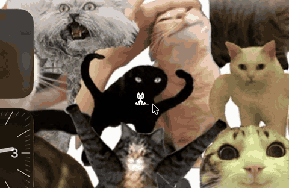

# oneko

The classic cursor-chasing cat, as a native tray app for macOS and Windows. Written in Rust.

<p align="center"></p>

- Transparent, click-through, always-on-top window, so the cat never gets in your way.
- Follows you across Spaces and over full-screen apps on macOS.
- All five original characters: neko, tora, dog, sakura, tomoyo. Switch from the tray menu.
- Menu bar / tray icon with Pause (hides the cat), Character, and Quit. No dock icon, no taskbar entry.

## Install

Grab the latest release from the [Releases page](https://github.com/ivedmohan/oneko/releases). Both builds are
unsigned, so each OS shows a one-time warning.

### macOS

Open the dmg, drag Oneko to Applications. The app isn't notarized (that needs Apple's paid developer program),
so macOS will say **"Oneko" Not Opened, Apple could not verify...** the first time. One-time fix:

1. Click **Done** (not Move to Trash).
2. Open **System Settings, Privacy & Security**, scroll to *Security*: you'll see *"Oneko" was blocked to protect your Mac*. Click **Open Anyway** and confirm.

Or skip the dialog entirely from Terminal:

```sh
xattr -dr com.apple.quarantine /Applications/Oneko.app
```

### Windows

Run the exe. SmartScreen will warn because it isn't code-signed: click **More info**, then **Run anyway**. One time only.

## Build from source

```sh
cargo run --release              # classic 32px cat
cargo run --release -- --scale 2 # bigger cat
cargo run --release -- --character dog
python3 scripts/xbm2sheet.py <oneko-src> assets  # regenerate sheets from the original XBMs
python3 scripts/make-icon.py                      # regenerate app icons (needs Pillow)
scripts/bundle-macos.sh          # universal Oneko.app + dmg in dist/
```

## How it works

`src/cat.rs` is a port of the state machine from [oneko.js](https://github.com/adryd325/oneko.js): walk toward
the cursor, stop when close, get bored, scratch walls, fall asleep. Every 100ms the app reads the global cursor
position, advances the cat one step, moves the window and swaps the sprite frame.

Drawing is native per platform because off-the-shelf software buffers ignore alpha: an `NSImageView` on macOS,
a per-pixel-alpha layered window (`UpdateLayeredWindow`) on Windows.

## Credits

See [assets/CREDITS.md](assets/CREDITS.md). The cat is from the 1990 public-domain X11 `oneko`; the sprite sheet
and behaviour come from adryd's MIT-licensed `oneko.js`.
